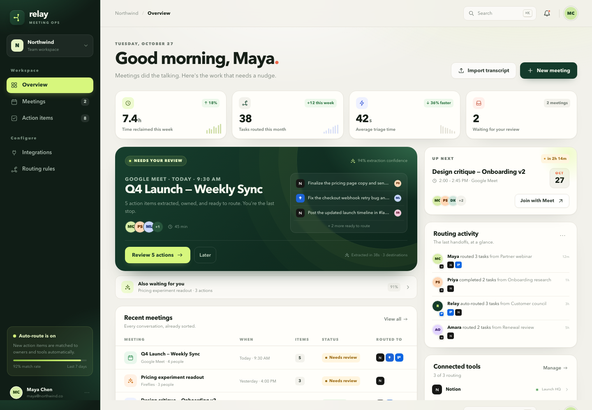

# Relay — AI meeting action router



**Live demo:** https://s20260125-prog.github.io/hihihi/

Relay turns a meeting recording or transcript into **owned, dated, routed action items**. It is the product surface for the pipeline in the brief: transcribe → extract structured actions → review → push to Notion, Jira, or Trello.

The demo is a self-contained static app. It runs in the browser with no build step.

## Run it

Open `index.html` directly, or serve the folder:

```bash
python3 -m http.server 8000
# http://localhost:8000
```

No API keys are required for the demo. GitHub Pages deploys automatically on every push or merge to `main` through the workflow in `.github/workflows/`.

## What is interactive

- **Overview** — meeting inbox, time saved, routing stats, next meeting, activity feed, connected tools.
- **Review & route** — open the Q4 Launch meeting, edit titles/owners/dates/destinations, select or deselect items, add/remove actions, bulk-route, then push. A success receipt shows the mock Notion/Jira/Trello records created.
- **New meeting** — paste a transcript or use the sample. Relay runs a staged extraction animation and returns editable action items with owners, due dates, priorities, destinations, and confidence scores.
- **Extraction heuristics** — the browser demo parses speaker labels, commitments (`I'll`, `can you`, `please`, `we need to`), due phrases (`by Friday`, `tomorrow`, `next Tuesday`, `end of day`), urgency cues, and likely destinations. This is a deterministic stand-in for the production LLM step.
- **Meetings** — filter by review/routed status, open a meeting summary and its actions.
- **Action items** — search, filter by owner/destination/status, mark done, open the source meeting.
- **Integrations** — connect/disconnect tools, configure default workspace/database/project/board, toggle routing rules, copy the webhook endpoint, send a test event.
- **Command menu** — `⌘K` / `Ctrl+K` to search meetings and actions or jump between pages.
- **Responsive** — mobile navigation, stacked cards, touch-sized controls, bottom-sheet modals.

Data is in-memory, so refreshing resets the demo. Audio upload is a UI simulation in the static build: it runs the sample transcript through extraction rather than calling Whisper. Real transcription, LLM extraction, and tool writes live on the server side described below.

## Files

| File | Purpose |
| --- | --- |
| `index.html` | App shell, pages, inline SVG icon sprite |
| `styles.css` | Design system and responsive layout |
| `app.js` | Seed data, extraction demo, review/routing flow, modals |
| `.github/workflows/deploy-pages.yml` | Automatic GitHub Pages deployment on every push to `main` |

## Production architecture

The demo intentionally stops at the browser boundary. The real service should keep provider keys and OAuth tokens server-side.

```text
Zoom / Meet / Fireflies ──▶ ingest webhook
                               │
                    ┌──────────▼──────────┐
                    │ Transcription       │  Deepgram (live) / Whisper (batch)
                    │ + speaker diarize   │
                    └──────────┬──────────┘
                               │ transcript + participant roster
                    ┌──────────▼──────────┐
                    │ LLM extraction      │  JSON schema + source quotes
                    │ + owner resolution  │  roster match → calendar → fallback
                    └──────────┬──────────┘
                               │ draft actions
                    ┌──────────▼──────────┐
                    │ Human review        │  this UI
                    │ approve / edit      │
                    └──────────┬──────────┘
                               │ approved actions
              ┌────────────────┼────────────────┐
              ▼                ▼                ▼
           Notion            Jira             Trello
         database item     issue + sprint     card + list
                               │
                    Slack notification / audit log
```

### 1. Ingest

Support three entry points:

- **Recording URL** from Zoom/Meet/Fireflies; download with the provider token and submit to Whisper or Deepgram.
- **Live audio** via Deepgram streaming for in-meeting capture.
- **Transcript paste/upload** for teams that already have notes.

Normalize the raw transcript into `{ speaker, start_ms, end_ms, text }` turns so extraction can cite `source_quote` spans.

### 2. Extract with a strict JSON contract

Use function calling / structured outputs so the model cannot return prose. Example response:

```json
{
  "meeting": {
    "title": "Q4 Launch — Weekly Sync",
    "summary": "The team held the Nov 4 launch date…",
    "decisions": ["Launch date locked: Nov 4", "Pricing copy is the gating item"]
  },
  "action_items": [
    {
      "title": "Finalize the pricing page copy and send it to legal",
      "owner": "Priya Shah",
      "due_date": "2026-10-30",
      "priority": "high",
      "destination": "notion",
      "confidence": 0.96,
      "source_quote": "I'll finalize the pricing page copy and send it to legal by Friday."
    }
  ]
}
```

Guardrails:

- Resolve owners against the participant roster; surface low-confidence matches instead of guessing.
- Resolve relative dates against the meeting date and the organizer's time zone.
- Keep a source quote for every action so the reviewer can verify it.
- Validate with the schema, then run deterministic routing rules (urgent → Jira, legal/copy → Notion, social/assets → Trello).
- Never route an item below the confidence threshold without human review.

### 3. Route adapters

| Tool | Create call | Useful fields |
| --- | --- | --- |
| Notion | `POST /v1/pages` | database_id, title, owner, due date, priority, source URL |
| Jira | `POST /rest/api/3/issue` | project key, summary, description, duedate, labels, assignee |
| Trello | `POST /1/cards` | idList, name, desc, due, idMembers |
| Slack | `POST /api/chat.postMessage` | channel, owner mention, deep link to the created record |
| Zapier | Webhook subscription / action | fan out `action.routed` events to any of 6,000+ apps |

Operational requirements:

- **Idempotency key** per `(meeting_id, action_id, destination)` so retries do not create duplicates.
- Store the external record ID and URL on the action, and show them in the success receipt.
- Retry with exponential backoff; dead-letter failed routes and surface them in the UI.
- Use OAuth per workspace, encrypt refresh tokens at rest, and never expose them to the client.
- Add an HMAC signature and timestamp check to inbound webhooks.

### 4. Webhook API

The demo exposes a sample endpoint in the Integrations page:

```http
POST https://api.relay.app/v1/meetings/ingest
Content-Type: application/json
X-Relay-Signature: sha256=…

{
  "meeting": {
    "title": "Q4 Launch — Weekly Sync",
    "transcript": "Maya: I'll send the timeline…",
    "participants": ["Maya Chen", "Priya Shah"],
    "route": ["notion", "jira"]
  }
}
```

The response should return the extraction result plus a `review_url`; routing happens only after approval unless the workspace enables auto-route for high-confidence items.

## Design notes

- Palette: forest `#143b2b`, lime `#d7f77d`, warm paper `#f2f1eb`, coral accent `#ef6a4d`.
- Typography: Avenir Next / system sans; monospace for IDs and the API snippet.
- Layout: 244px rail, 1320px content cap, 18–24px radii, compact 10–12px metadata for dashboard density.
- The signature dark "ready to review" card anchors the page; the lime is reserved for actions and success states.
